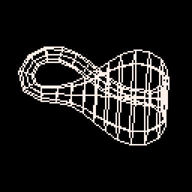

# Klein Bottle Tweet
A [Klein bottle](https://en.wikipedia.org/wiki/Klein_bottle) non-orientable surface
that is related to the Möbius strip.

This can be rendered so compactly thanks in part to the [Euler spiral](https://en.wikipedia.org/wiki/Euler_spiral)


[](https://minimechmedia.itch.io/klein-bottle-tweet)

Leave a comment on [Twitter](https://twitter.com/MiniMechMedia/status/1759323397199217082) or [itch.io](https://minimechmedia.itch.io/klein-bottle-tweet)

This cart is (almost) tweetable at just 354 characters.

## Source
Remix it on [pico-8-edu.com](https://pico-8-edu.com/?c=AHB4YQIbAZzrwe3H3337_bN33-8IQddVzTs0QdIYXO9wyiXHFMlSHzxB3xdl017-Aia4P7s-tcQzdEFZPMQrjHR1sZGuRKUFHiGq8ocY8kbSBG1_3lmB4XZG8pVIQURARD8o6OKqum6nnyhX6jZ-iChoqizLqixrs6bKKlWiUpUsUCW6R2k8Q8HSiRNbY-fd1s116XH3pUn2ElnbvETzFq8RjRlhpyrGVqoiKqrN6CmypdG3KPMbjwyWlqbSeK68sL2xK5bqtbEmDs488iUGsqwLw35npu9v3BscuLRYWF8Jw2p1einbq8u0vzMbGX2H6iWq2eGtU-cGioGBxYHN5QmrDFsltcFItnzGQm8KoYBwZnJILCDayMOJjaZx32KVtmoh3Ww1UVUrTlvf7roLgqcoAomiMYmiDYWCE1K9gYnpYGnOFlbYbJqJzYn2KbIsii2XpW5JtQwuWJxbzTZOEBcqZiaGbHLGRLTUzsxuD_x0I3lTFF030o1kWWiEmarcPmAxs1QUGnp_SIzo3lMv6ovt5WjrjuXB4orZCg==)
```lua
d=.0271
x=-36.3
y=0
q={}
i=0
c=cos
s=sin
for j=0,4427do
a=(j*d*.01-.779)^2-.107
if(j%369<9)b=j%9/8o=s(b)i+=1q[i]={x-5*o*s(a),y+5*o*c(a),5*c(b)}k=-y+5q[i+108]={-x,k*o,k*c(b)}
x+=c(a)*d
y+=s(a)*d
end
::_::
for i=0,441do
p=q[i-225]or q[i%25*9+i\25+1]or q[9-i\25]
a=t()/9
m=c(a)
n=s(a)
line(p[3]*n+m*m*p[1]-m*n*p[2]+64,n*p[1]+m*p[2]+64,7)
end
?"⁶1⁶c0"
goto _
```

## Explanation
Remix it on [pico-8-edu.com](https://pico-8-edu.com/?c=AHB4YR-7Dmrrwe3H3337_bN33-8IQddVzTs0QdIYXO9wyiXHFMlSHzxB3xdl017-Aia4P7s-tcQzdEFZbjxDFDVx8gbpRv0OO6ZImuAZ6vPOCgw3M5IvRNIhyiHCQUEXV9V1M-1KuVG3_UgUNFWWZVWWtVlTZZUcUSlHFsgRKY1sbJXZSV01VKZjUVJIluuaYqJMqqYNmnxiKc6KMKteIVkrNmpRg5lyIi7aw-RD4qkozZNuMGqrETONNW241S1MzEif1H21EqqIraWJwsBAEw6qIZS16oD8SJckI_FAu7My4p53qLt2JhM92In7sn2GMwshMY1RMXG4IlMvyaQI_jZr43Sm29AeeImuE1oo86lBa3RNmkivrCRLdRYpFQmMb0r-RF9UtkRfnG2tK6x80PVD5U4qTqQyUDUzXaEyoIAqXM5CcCAf0g9pqqjP80rfoItzvaUmzbsqK9K0a5TDL3kkzfSjFlIIW0GBnUyypcqzJGwnJsoo7Dwj0JDEpSFzRYYs1Fk0Qhh2ghAyENFT6CyMrWi2zlR5GSd1nkYL1YSQQDfWvYIXHmL3IQRfsuvqZvK8scj0yQYGTCn7JjI8thPlxdjeRjSXzAyJxTRN2ibJTrcVpknWVF3TLivN3CcoI02Q5t2ecsFCr01_CCcsClJkY7oxaS9PMyAbsiYik7VlkiayKQudaEEYdrEoQ2qJBRGjYELEQKOmS5sujYLUFSsTTzHXyYgFSjUTgnZ7VVOsxjulqMWCTkFQ1ysL9pFfXupWEg2RTbWCpok3lUjFblophRXxBxmLPfmAUukkqbKdeGdNLm9goOmadkVlZEGmosmUl8pSiHiiGohkzpHVajUCSvWEWEMh2bGkl664nipTfTSx9sijQxspEKhQ2FF1aGtxBBmPLtlJZA6UWOTQatUZdY1COTwTZaNq-l9aPnIRhYibTqqKizKWYeWmcqkrSYa0K2Mprz6Sdb91C9MqjrVypHI6l3QrfBCk-NEE4WyuLx7ECNmKk0AhQiPRIIJdYZUv9VtyE8oTgh1PEe4EsipFHlS17OFU2C3UbTSwsBJYQ_sr6AeWO33YpA4q5THZnRxjgkbiTN88UZjFslDxUNyEElYLI0GXTJBAoEE0SqrBVLFD70-KI_ijKXWxzBrKF3EXLpUKOeqpAp8Tui1iD0oNYgYDGjq4ECRRJGsDC_HXijbWVB2IP3T1hDZmGmmoybGJ8jTRCLCEJ9VqG9lQsJWy7mNuCxLZ3MKJwKqZCVv9nqAlvmBNH6UzKY8tqSZdDv_lSb0x4JReuoeWgkJR4npAqlwjA8JSZearqemBpOr3BEdkcYQy2qqJmjH9HAIIRxw3bBZ_I124RcihL5FmsQ6xWrrCDgjCuVDUG0KJQ0kTDxVpnpViNEo9U7GWT1gvRFGjhSyAqTwsf2C5iXUh0byJFuR89G4m2pU_VtfYWBHqWhLXgOqQmTZq6SN0qAm25DRWQnsITA_tKPJIQUhHR_3QWii0p46j06ZK3FR9PyP0JHGSE0BQsHCmMl0m_tFsJBI_Gv2bCaNjh3ZnLz1T72dpjpnCoUCzsjK1Ieu3JPyPdkOzpiGdIMWaoWImG1Gj3ogX5u68NE6ysWxF_2dvYWdI1U9cYGVeBGdta1BxcmdmSC1Z4Ge42tEcli7YGcqmchEOZ_RRHwUVuAUubdQjSbKQyCY06hf17kQPUEJyd4223EusPUXaDHpgK2LDMIUZ1g0QodGnWBge02jJ3_I1tHwEgtK_DjeS6SFld4hWLyzFmZ7hRkjaQeNGItXwoUs4VaCFaaYU71IKE7s2GJntF2EiZE8hIh0MhwekhJRp8kzDg2gEB6PBDckrwA3JpIcUfbSlWE3ca3l9aFSlcR1VarEwKsbVYZNaEgwT5owRqbFyYhN5gkTMl7QqYgFPBO204_2c9I9mk7MEonUWJgQq1qkv7Fyx1FoPTp9mYcYIFSgIJMmIipAwT8F_QlJioTdG64GVC9rJ0emGWcMjutMyi0CqprSktxEXMX6GT-onXWnDIo7qWlHllB3ZxZkpNA2bHldeE0-Z1OrZD6NOemVzSGsqLKdAO2BLCz8C46OqkPmZvXlTNN3SIG2KLFSrwRAaiWxBrdhMrr4lryUijqSPlQvGktEJvapESSuvB7rELyJZtZrXVrEyRVBiVdXp7Yj_cEHQAgWETCiTq0kF_HGBWMBuDhZiQkFbk1tjAxORnohEkd4PHwnMynNpS6FZiFCtim4X79fAKAKmwZAofkg2CqBrYWJK80f8Y026DyrD0S9lw1QXnoWhidmBvSNGNYPEfYTyCVPi7MqBkENFyq6qViv4FHGCLs_koPPUyopQscKUXvycUS5O99nkCVYRk1hVmlT30a1TXo-URCmwMVntsL_YZ7QsUi2Le2X8g-JBxdx6IvgghvQcs0O7S3oUbbur-LTeI3IofwiJPPBIAIUMpP3U3tDc7LmiFhdvL4JxSLhmACAYU8AXMA2hiJgxuSJYoQe7wqWooyK6DErjBZhBBBocU2PQ_FiS8JGpUuZS5CJ0gZU9YQqxnxVN0kxdVslVZ3_S4wfth0iOWw1PdmREz4GOwqNi7g3RccgUw4B4dcoP8VtdSSllS0hPzFUENqriSCRB_qjST_JL7phcWZyYWDhn3U9TMlOuGjHU0MXltkyrKgxWjmnHVVNqy3tC9pFcPxWc9F4l0D_F818C7D8NA-ZBh2yMDKzAiHiwP7BlClGpKf4QuaO4I77DTeKTg-WMVGMwjiujCDeootMORwdszVXb2BCsyDFnMkWOESVxkbJIZop559hLKIgcxcFx4oANIhwNB3yHVWEsTP6mPqgmmr0WEsKvbrXflfVYXyNPsSEFU3cuNFrnCnNFnvCEsppI0tTZRbU1WxZZGDq62HNU6Hh0GRKPKMPnDln4-_BfMc1OWCBV7pc_tYCv1u0c54pLwJukgmQds04o-1bvlcv-jx2V34lwN9mNVRaFnuhxDIXCThAdmEjGZoBdHOpkEj7kIIpMI_LbC1wcKu0jQblSu12a_VL9XZlaGiyDeiodkl1QrohikRhkE9lpWtwYx0QFzCFBiE1D2DhWBLq-KWMRbU2kW2NFng_V5EqmmJBsdFEIhiQCHtcMnJJUe-2AGgVPjyj86bSo5S3qjygoDwXV6tQsiQkTkhg7kA4vRvNT9gERwpUR6X2MIc-gjuA-Yk4NGFT48kXTREMK0QKibDMCUCQ6ZsmwHEal2Z9RKQLd-irJQ3A_-D0kzdoMzKdzgURGkURrnD5O2X5JskvXYTDaOUB3J5FuUswbGBLmP3SW5Lk1bqT-o-qjwhJ1C3I4tBCq-IORIyr-woLw-78U_SPcjpE915_C-Ycaxry0I0iEX1grMghWQ1A0TEOD3cDWSNOFY_GkEQKjKAlyekg6hL8EKiyTK2JNkhCT0l3hkKSQrvkgoKRn8fGYCvVEGF2kgKlSZiipF2bUnFRR0qEt6CGTCGOrsbhCtlK_Hy9AC6YjM7XcjsCsxA_nkyRbYDPojbWyCYsF3cFOmLjHVfGKXMZjxC_eWbEmCdNLhM0kU5oWVwtGRgYqOVMxLMlDbcK22U_Gqw5CRHeVugRHJEL4gTCaCIpeqkQaZVrMLyF5IhEVxinU40KWcEiSBlOBLLmLIVVCCaEgLBfTjd0BER6JjJVugPiHZgC7dI6ty6pwYKQtlstodKCbh4_QciqZvSTYnivOCKJLxqMsG__a0eacdjoq9aBWtkgtZOQSmBphkBD2LQdeFexQECnrjocTSzeoRZDVyk9hilXtnJUkmyEMMSEhoCWZPia4pgi0KOdKcCPUihJE4WMRECoZ15WLJ5u0spdmRVFg9IhUysAxrDVQbG3RTHhF_FSpZefEg6IsXPFUMCBNQpGB1CoeIW_tOsUoADLQjaK6sm5Lc6Qo9Cn1HNcnsH2EV4hWtRJmRXjqoAaX8gxQ21BFbUNJXYuTX0RRVLsC_UtCmTvmJioWVTRndJF0RPSs9Hf08DR88HVQjMsj3R0iBVXVBrpEXFimZ8bjwphLuL-I6oQQZKy0CTBmCzqo265r54el1Us-5NAK3V4Y85Fil6LIohxJmqLTOEXJZMzBuMJDGqXT6QZMEwntdNYC2LFu4pypKfmfDKsDBoUu_sm01euJN9olQVdJ9-8Z1eI7omsTSiiTTVoiBUH5GZnbbbIripThvVLPN_PNACYZyXpsHqMeNAGeQsBWVCIO8SXi5bmEVMiEo_BF3LAVnnxhIziDzoYUEFgnHKQcTsA1IeUirhdPnSYJTJYMjKQdOBMMGJfqzSWs0dQUaJ68G8ERQ1WJVjTnAmoqk6Pb0B7HIiSO0k1BxUhFI0hIgs4i0CwymCyIvEu8RdIRrMPb1fpzZkgCDijEtZJKpyZJr5C9kUirc1wXS9aUlKoJ_Y2RNtVVj8z0GRrxCXZFghcz3yfT3h1YramGSFU8W62CEQuJS20dLSKW8kh42DccnseudsRys61mjIFlDF8oK8X1pvBQjplsaGUBCQpZORyyP43ekezLfqH8sVanBGfUgnIx7Jl0KzIU8BTEMqdhNQTp5djjEyOJG4IlEpMaWFiaqCS-ui6Vq2P30a4MwiVaCxcoFAOqCaYOoQdxl8d5msr5DOAhKUgT0rpgujS3vHzDln61-HctX7WBZeWYExy2Btga7Q60MhRLyQj-FKwUm5lJTtBv6jYYrDDjk3KuxRBrjKfl1pDS1hkQEdnmMrJJUCMrbCg0smhJgTBLpIvR-Hxq59FKNNS6Nwwhmqim14SQwxJrhuOKyWVpnqXNkW6j3K1WougCX2VHVF0YKPjUQ3Xrg8nNubPItai-4JydCd2LutZI2aCgE0YgQ88TjS8xEcuovYT9uGJIUWS0RjSA8cTqh6IVKwNoasKj51gvVcVuuOCQNtcPSKIDZrQtzmg=)
```lua
-- Let's draw a Klein bottle! It will consist of 2 main pieces,
-- the neck and the base. For both, we will use a curve that's
-- shaped like a question mark `?`. For the neck, we will form
-- a pipe surface by sweeping a circle through the question mark.
-- For the base, we will form a surface of revolution by rotating
-- the question mark around a straight line.

-- To generate the question mark curve, we will use a Clothoid aka
-- Euler spiral aka Cornu spiral. This curve is parameterized by
-- the Fresnel integrals, \int_0^L cos(l^2)dl, \int_0^L sin(l^2)dl
-- This curve has some very convenient properties:
-- * It is naturally parameterized by arc length, so
--   * If we calculate points at regular intervals of our loop index, 
--     they will be equidistant along the curve, which looks nice.
--   * The derivative (tangent vector) will already be normalized to 
--     unit length, saving some characters
-- * It is defined by integrals, so
--   * We can reuse results in subsequent loop iterations
--   * We get the derivative (tangent vector) for free
-- * The curvature of the curve is a linear function of arc length, so
--   * We can build a train track that follows the curve and passengers
--     will not experience jarring acceleration. Just kidding, we don't
--     need that use case. But the curve does look visually appealing
--     and smooth.

-- We only need a small segment of the Clothoid's infinite extent to get
-- our question mark curve. We choose endpoints so that a line connecting
-- them is a bitangent (tangent at both points). This makes it so the neck
-- smoothly flows into the body. Then we rotate so that the endpoints lie
-- on the x-axis, making it easier to calculate the surface of revolution 
-- for the base. Then we translate so the endpoints are equidistant from
-- the origin, allowing us to re-use the neck curve for the body curve.

-- The mesh is built directly in screen pixels, which keeps any scaling
-- factor out of the projection and makes the neck radius a bare literal 5.

-- A delta of of arc length
dl=.0271
-- x,y will be our position on the curve. Initialize to first endpoint
x=-36.3
y=0
-- Holds the x,y,z of each point in the mesh
-- (as positional triples -- dropping the x= y= z= keys saves more
-- than the [1] [2] [3] indexing costs later)
mesh={}
-- Index variable for the points list
i=0
-- Here is where we calculate the curve and the mesh based on that

-- 4427 happens because we are inlining a couple of loops here
-- Mesh will consist of 12 "slices" of the bottle
--   (Actually there are 24, but we calculate 2 slices at a time)
-- Each slice will be an octogon of 9 points (first and last overlap)
-- We take a slice every 41*9=369 iterations to preserve accuracy of the curve
-- 12*9*41 = 4428, and this is a 0-based loop
for j=0,4427do
-- (Signed) arc length of the curve so far. Offset by -.779 since that is the
-- arc length corresponding to our starting point. The *.01 converts our
-- pixel-scale arc length to the curve's own unit scale
l=j*dl*.01-.779
-- Value to use when calculating the next part of the Fresnel integrals
-- We offset by -.107 to align the bitangent with the x-axis
a=(l)^2-.107
-- Calculate the tangent vector
tx=cos(a)
ty=sin(a)
-- If this is one of the first 9 iterations of a block of 369, take a
-- slice point. The 9 in a row form the octagon; the curve only advances
-- ~.2px across them, so the ring stays clean
if(j%369<9)then
    -- To take a slice, we need to take where we are on the curve and
    -- * for the neck, form a circle centered at that point and perpendicular
    --   to the tangent of the curve
    -- * for the body, form a circle that intersects where we are on the curve,
    --   centered on the x-axis, and perpendicular to the x-axis

    -- The angle around the octogon for the slice
    theta=j%9/8
    o=sin(theta)
    i+=1
    -- Forming a slice of the neck. Calculate a circle centered at where
    -- we are on the curve, and perpendicular to the tangent of the curve
    -- The bare 5s are the neck radius in pixels
    mesh[i]={
        -- Note that the normal convention would be to use cos, cos, sin.
        -- But using sin, sin, cos makes it easier to draw the bottle later on
        -- Note that we turned the tangent vector (tx, ty) into a normal vector by
        -- doing (-ty,tx)
        x-5*o*ty,
        y+5*o*tx,
        5*cos(theta)
    }
    -- Forming a slice of the body. We are rotating the curve around the
    -- x-axis, so calculate a circle with radius y, centered on the x-axis
    -- and perpendicular to the x-axis.
    -- Except that would result in a 0 width at the ends, so we actually need
    -- to offset the radius by the radius of the neck.
    -- (written -y+5 rather than 5-y so the next statement can butt
    -- right up against it with no space -- `5q` lexes fine)
    bodyradius=-y+5
    -- Add 108 because there will be 9*12-108 points in the neck when we are
    -- done. And we want the body points to come right after.
    mesh[i+108]={
        -- The curve of the body is actually a mirror image of the curve
        -- of the neck. Achieve this by doing -x
        -- Note again that we are using sin, cos instead of cos, sin to make
        -- it easier to draw the bottle later on
        -x,
        bodyradius*o,
        bodyradius*cos(theta)
    }
end
-- Add the tangent vector times out delta of length
x+=tx*dl
y+=ty*dl
end
-- We now have our mesh populated. Time to draw the lines connecting the vertices.
-- The strategy is to do 2 passes.
-- First we draw a line connecting every pair of points that has an index of 9 away.
-- This connects corresponding points of each slice, drawing the "lines of longitude".
-- Then we connect every adjacent point (with respect to the array indices) with a 
-- line. This will result in drawing all the "lines of latitude". 
-- Technique borrowed from https://x.com/MunroHoberman/status/1335957716053987328?s=20
-- While we're at it, we will also rotate each point around an angle parameterized by
-- time, to animate a rotation.
::_::
-- We do both passes in one loop. The second pass handles all 24*9=216 points in the bottle.
-- The first pass does the same, except we need to draw the first slice twice, so
-- 25*9=225 points. This gives us a total of 441 iterations.
for i=0,441do
-- The first pass can be thought of 9 smaller passes, one for each vertex of our octogon.
-- 
-- i%25 tells us which slice we are on. Then *9 to get the base index for that slice (index of 
-- the first point in that slice).
sliceindexbase=i%25*9
-- Calculate which vertex of the slices we are working with
sliceoffset=i\25
-- Remember how we said we needed to draw the first slice twice? This `or` makes
-- it so we loop around back to the first slice. You might think it should just be
-- mesh[sliceoffset], but this would result in the lines criss-crossing.
-- This is actually a consequence of the non-orientability of the Klein bottle. Taking
-- the modular inverse fixes it though. This is also the reason we used sin,cos for
-- calculating slices instead of cos,sin. The correction is much simpler this way.
    p=mesh[i-225]or mesh[sliceindexbase+sliceoffset+1]or mesh[9-sliceoffset]
-- The leading mesh[i-225] is for when we are actually onto the second pass.
-- The second pass, logic is much easier. Just loop through each point. During the
-- first pass i-225 is 0 or negative, so that lookup misses and the rest of the chain takes over.
-- Almost there, just need to apply a rotation. Here is our angle. The 9 is unrelated to our octogons.
    a=t()/9
-- This calculates a composition of rotations along 2 axes. p[1],p[2],p[3]
-- are x,y,z, and the mesh is already in screen pixels
    line(p[3]*sin(a)+cos(a)*cos(a)*p[1]-cos(a)*sin(a)*p[2]+64,sin(a)*p[1]+cos(a)*p[2]+64,7)
end
-- This print does the job of flip()cls(): the P8SCII control code ⁶1
-- (\^1) waits a frame -- that's the flip -- and ⁶c0 (\^c0) clears the
-- screen to black for the next frame
?"⁶1⁶c0"
goto _
```


## About


Source code available on [GitHub](https://github.com/MiniMechMedia/pico8-games/tree/master/carts/klein-bottle-tweet)

