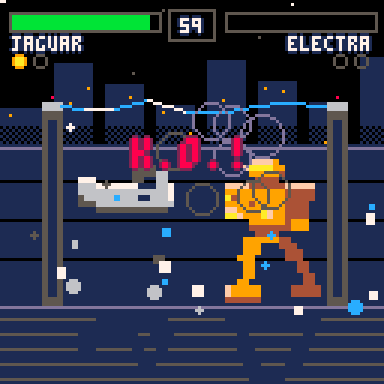

# One Must Fall: PICO
Giant robots. One pilot walks away. A PICO-8 demake of the classic DOS mech fighter *One Must Fall: 2097*.

## How to Play
Best-of-3 rounds versus the CPU (three skill levels) or a friend — pick your HAR and reduce the other machine to scrap.

* **JAGUAR** — agile assault HAR. Special: leaping strike
* **ELECTRA** — fast, fragile, fires shock bolts from range
* **PYROS** — slow heavy burner with a flaming rising uppercut

## Controls
* Arrows — walk / jump / crouch
* O (Z) — punch (crouch for low punch)
* X — kick
* Down + X — special move (has a cooldown)
* Hold away from your opponent — block (chip damage still applies)

Player 2: ESDF to move, Left Shift / A as O / X.

## Arenas
* **Power Plant** — night skyline, arcing tesla pylons, reflective floor
* **Desert Dusk** — sunset dunes

## About
A tribute demake of *One Must Fall: 2097* (Diversions Entertainment, 1994), rebuilt from scratch for PICO-8 — sprites, music, and code all original.
